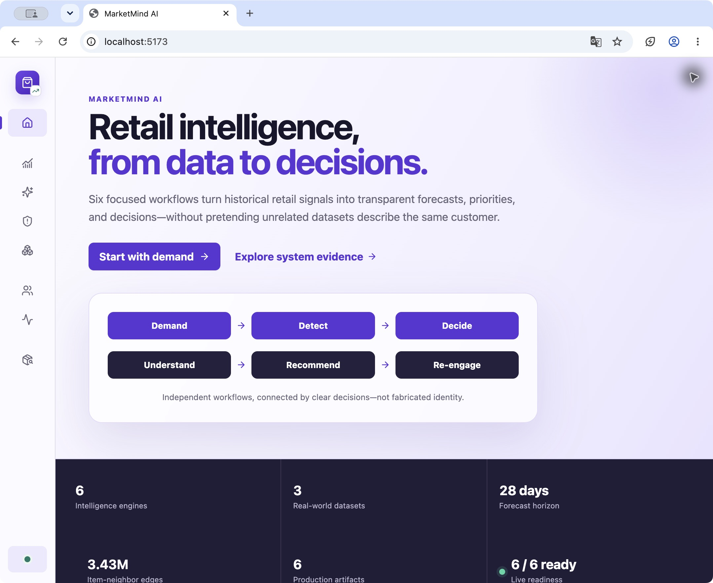
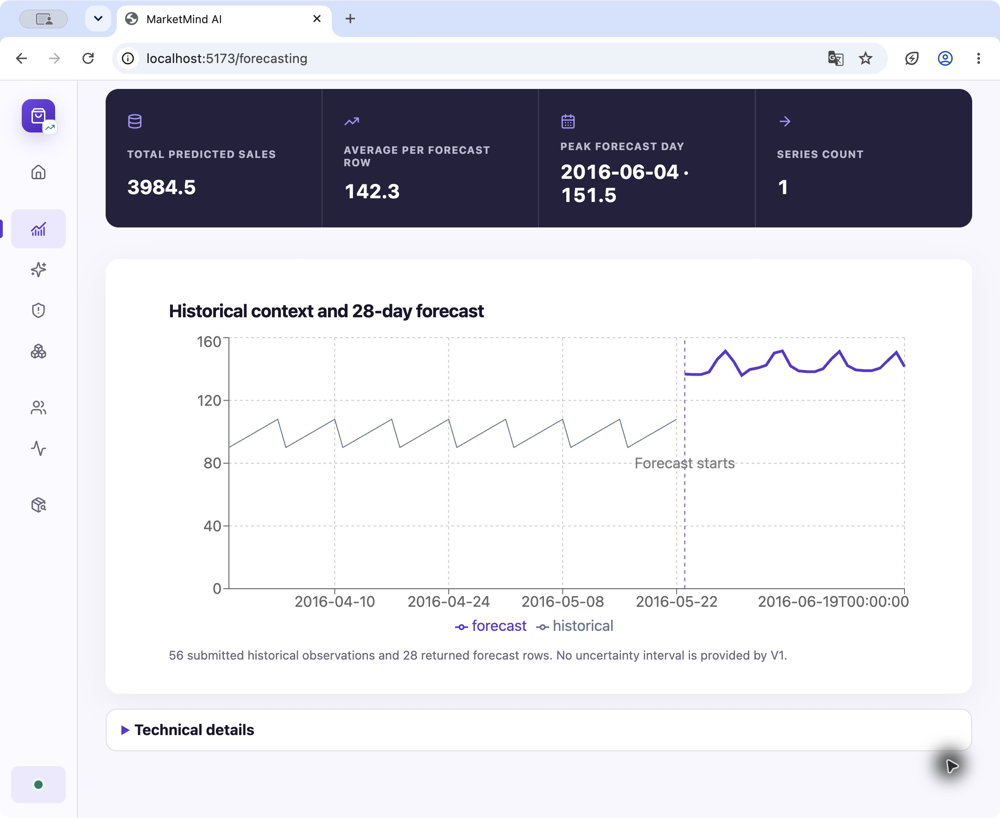
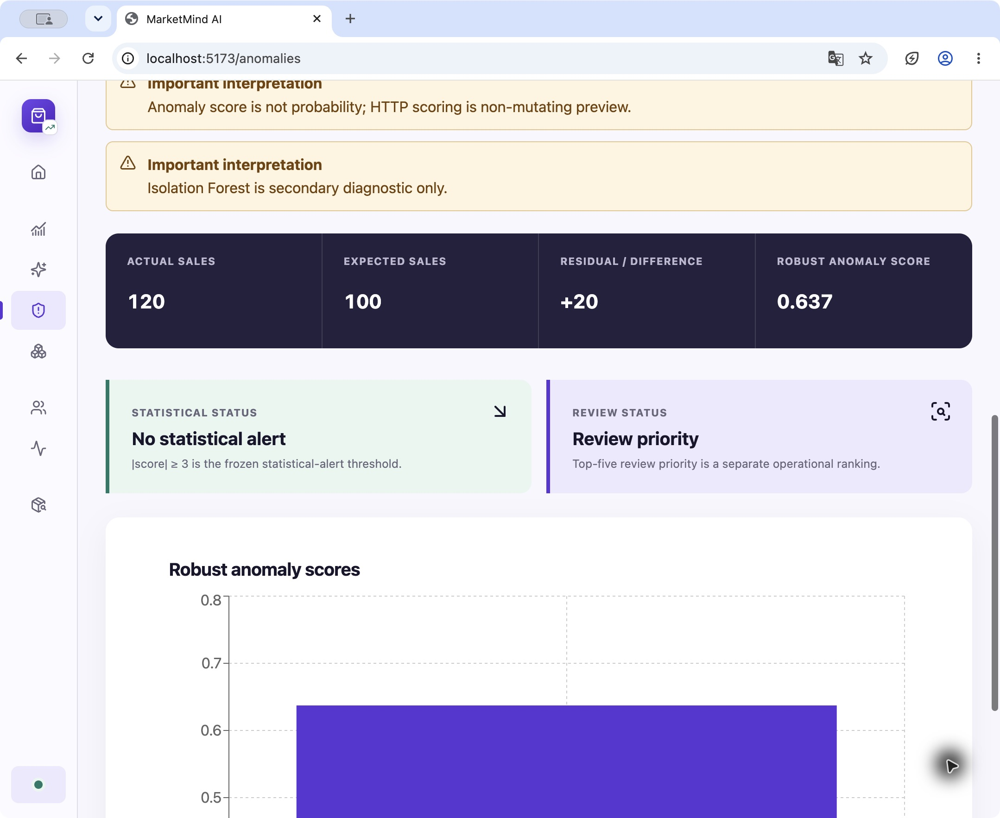
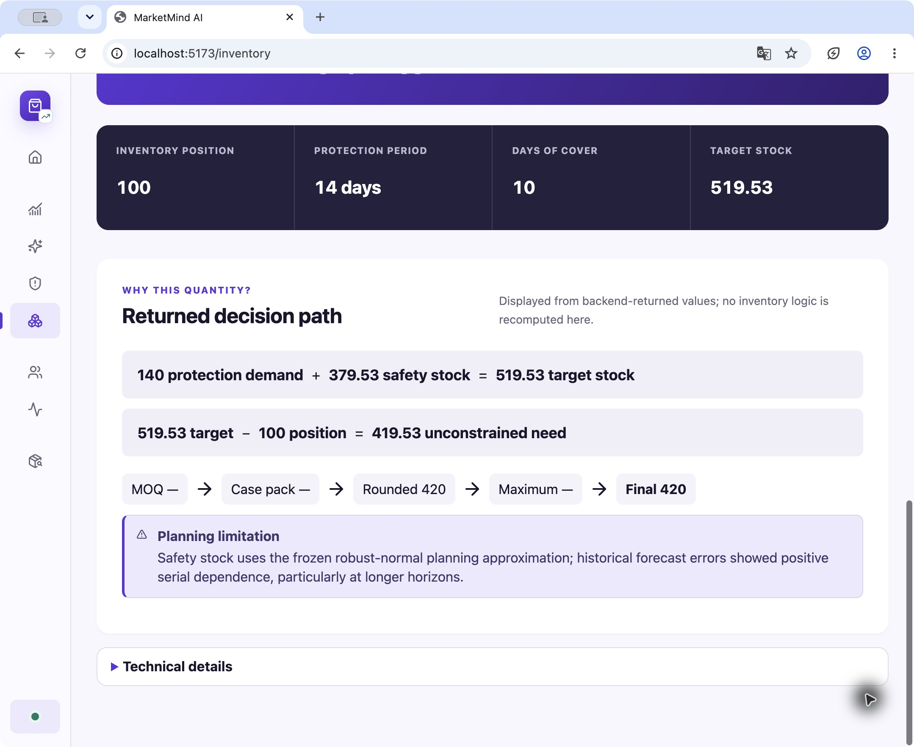
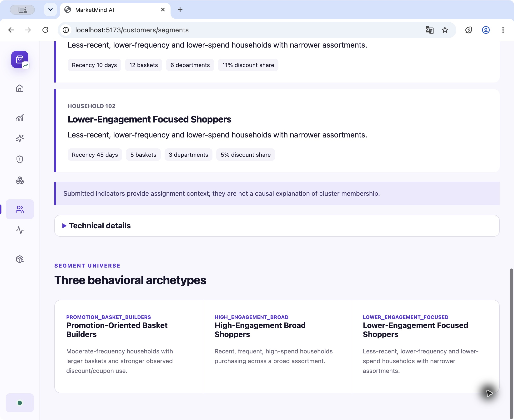
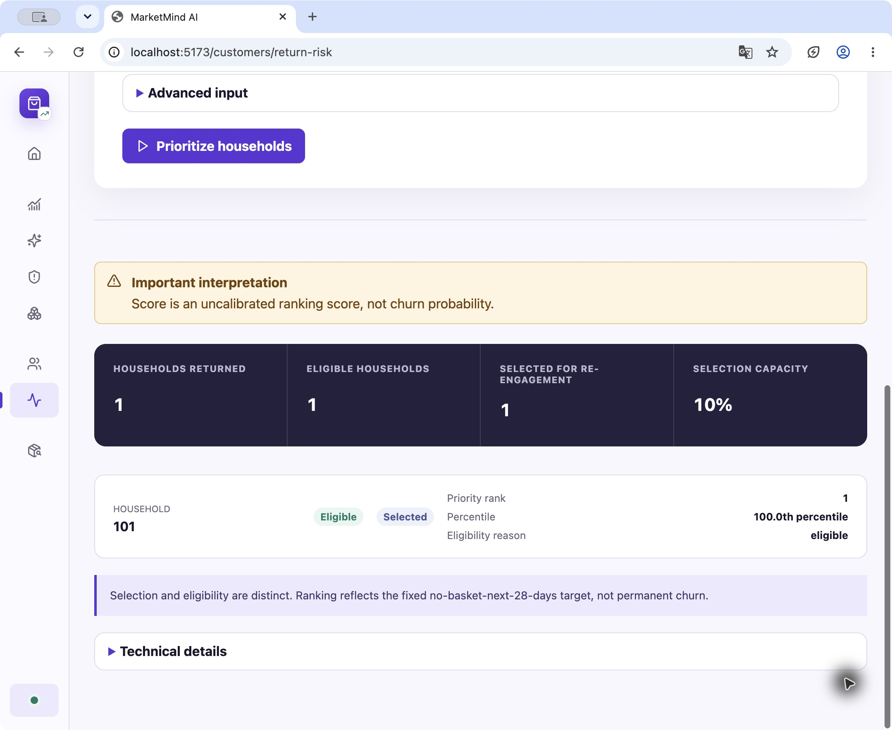
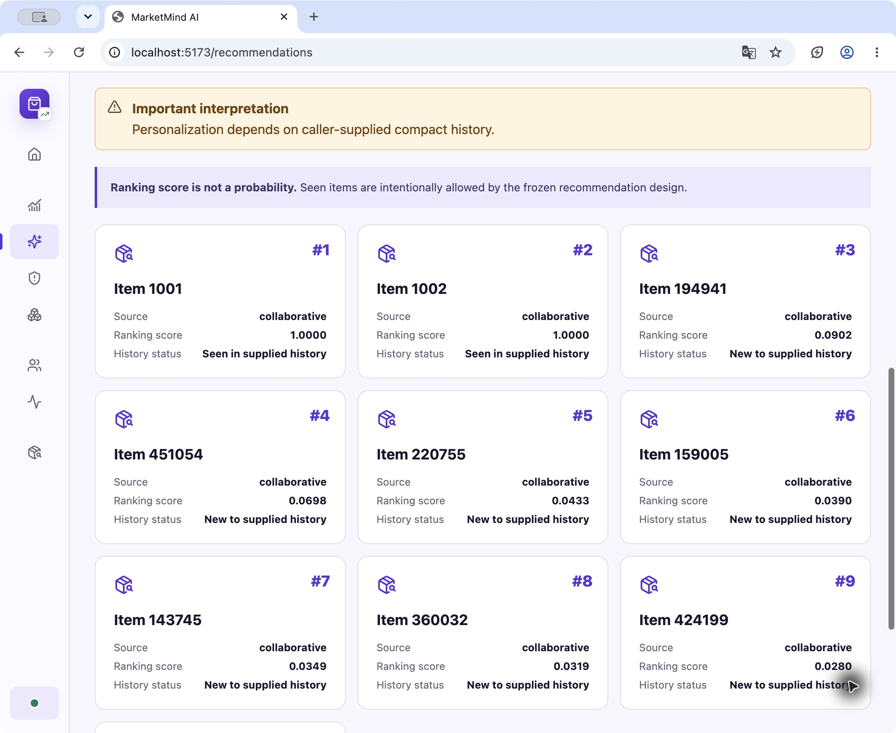
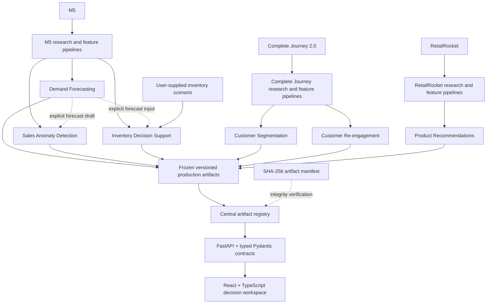

# MarketMind AI

MarketMind AI is an end-to-end retail intelligence and decision-support portfolio application. It combines six focused machine-learning and decision workflows behind one typed FastAPI backend and a responsive React/TypeScript workspace: demand forecasting, customer segmentation, customer re-engagement, product recommendations, sales anomaly preview, and inventory recommendations.

The completed application runs locally from six frozen, versioned production artifacts committed to this repository; raw training data is not required at runtime. Public deployment is intentionally deferred.

MarketMind uses three real-world research datasets because no single source supports every workflow. They remain separate analytical domains—not a fabricated Customer 360 and not one shared customer universe.

| Project evidence | Current state |
|---|---|
| Intelligence workflows | 6 production engines behind one V1 API |
| Data foundation | 3 real-world datasets with explicit boundaries |
| Forecast horizon | 28 daily steps at department × store grain |
| Production artifacts | 6 immutable binaries with SHA-256 manifest verification |
| Application | FastAPI/Pydantic backend + React/TypeScript frontend |
| Verification | Linux CI, 223 backend tests, 5 frontend files / 32 tests, typecheck, production build, and API smoke |

## Product workspace

The interface is organized around business questions rather than model names. Demo inputs are deterministic and clearly labeled; all displayed model outputs are produced by the API rather than stored in the frontend.

### Overview



*The workspace presents six bounded retail decisions while keeping all three dataset domains explicit.*

### Demand forecasting



*A live 28-day point forecast with returned summary metrics, history context, and the fixed no-interval limitation.*

### Decision support

| Sales anomaly preview | Inventory recommendation |
|---|---|
| [](docs/screenshots/anomalies.jpg) | [](docs/screenshots/inventory.jpg) |

*Anomaly scoring separates statistical alerts from operational review priority; inventory exposes the backend-returned order calculation for an explicitly synthetic business scenario.*

### Customer intelligence

| Segmentation | Re-engagement | Recommendations |
|---|---|---|
| [](docs/screenshots/segmentation.jpg) | [](docs/screenshots/reengagement.jpg) | [](docs/screenshots/recommendations.jpg) |

*Prepared behavioral profiles, no-basket re-engagement ranking, and Item-CF recommendations remain separate workflows with explicit score semantics.*

## Six decision workflows

| Workflow | Business question | Dataset and method | Strongest verified evidence | Important limitation |
|---|---|---|---|---|
| **Demand Forecasting** | How much are we likely to sell over the next 28 days? | M5; one global horizon-conditioned `HistGradientBoostingRegressor` producing department × store point forecasts | Consumed lockbox macro RMSSE **0.80073**; **22.06%** better than seasonal naïve and **30.58%** better than historical mean | Fixed-horizon point forecasts; no prediction intervals, prices, or inventory state |
| **Customer Segmentation** | What behavioral retail profile does this household resemble? | Complete Journey 2.0; `RobustScaler` + KMeans with three frozen semantic segments | Production smoke reproduced **2,247 eligible** and **199 insufficient-history** households | Public API accepts prepared eligible features; centroid distance is not probability or confidence |
| **Customer Re-engagement** | Which households should be prioritized for outreach? | Complete Journey 2.0; ExtraTrees ranking for no basket in the next 28 days | Consumed lockbox PR-AUC **0.4999**, ROC-AUC **0.8691**; frozen top-10% precision **55.36%**, recall **37.83%**, lift **3.77×** | An uncalibrated ranking signal, not churn probability or permanent churn |
| **Product Recommendations** | Which items should this visitor see next? | RetailRocket; exact sparse item-item cosine collaborative filtering with deterministic popularity fallback | Consumed lockbox NDCG@10 **0.171158**, HitRate@10 **0.223996**, catalog coverage@20 **24.2774%** | Authentic catalog names/images are unavailable; seen items are intentionally allowed by the frozen policy |
| **Sales Anomaly Detection** | Did observed sales differ unusually from expected sales? | M5 forecast residuals; robust median/MAD score, inclusive absolute-score threshold of 3, and separate top-five review ranking | **1,960** consumed-lockbox rows produced **60** statistical alerts under the frozen policy | No authentic anomaly labels; unusual residuals are not causal diagnoses |
| **Inventory Decision Support** | Given expected demand and supplied inventory state, how much should we order? | M5 forecast input + user-supplied scenario state; periodic-review/order-up-to logic with robust-normal safety stock | Frozen invariants and a **70-scenario** production smoke passed | M5 contains no authentic inventory balances; safety stock is approximate and no historical inventory KPI is claimed |

Detailed methods, evidence, and production contracts are linked from the [documentation index](docs/README.md).

## Dataset boundaries

```text
M5                     → Demand Forecasting
                       → Sales Anomaly Detection
                       → Inventory Decision Support

Complete Journey 2.0   → Customer Segmentation
                       → Customer Re-engagement

RetailRocket            → Product Recommendations
```

These datasets support separate analytical workflows. Their identities are never joined, and MarketMind does not claim a cross-dataset customer journey. Inventory additionally requires explicit user-supplied business scenario state because M5 contains sales and calendar signals, not inventory balances.

## Architecture



Research and feature pipelines produce the frozen engines; runtime requests never train or refit them. The central artifact registry validates and loads each bundle once, exposes aggregate and per-module readiness, and allows unaffected modules to remain available if one artifact cannot load.

## Verified results

Results are deliberately separated by evidence type; metrics from different tasks are not directly comparable.

| Evidence type | What it establishes |
|---|---|
| **Development evaluation** | Temporally ordered baselines, controlled candidate comparisons, feature/strategy decisions, and frozen policy selection before final evaluation |
| **Consumed lockboxes** | One-time final estimates for forecasting, re-engagement, recommendations, and anomalies; these intervals remain immutable reporting evidence and are never treated as fresh test sets again |
| **Production smoke** | Artifact loading, stable schemas, deterministic inference, six API inference routes, readiness, and representative execution—not new model-quality evidence |
| **Decision checks** | Inventory formulas, monotonicity, forecast alignment, constraint ordering, and scenario behavior—not historical stockout, service-level, savings, or causal-impact claims |

Key results are summarized in the workflow table. Full evidence lives in the corresponding frozen reports: [forecasting](reports/forecasting/final_lockbox_results.md), [segmentation](reports/segmentation/productionization.md), [re-engagement](reports/return_risk/final_lockbox_results.md), [recommendations](reports/recommendation/final_lockbox_results.md), [anomalies](reports/anomalies/final_lockbox_results.md), and [inventory](reports/inventory/safety_stock_assessment.md).

## Product and engineering design

- Six immutable production binaries are versioned in a machine-readable [artifact manifest](models/artifact_manifest.json) with exact sizes and SHA-256 digests.
- FastAPI exposes typed request/response contracts, structured safe errors, request IDs, body/rate/concurrency controls, CORS validation, health, partial readiness, and model metadata.
- The React/TypeScript client uses TanStack Query, contract-shaped types, accessible interaction patterns, responsive layouts, explicit loading/error/zero-result states, and progressive disclosure for full payloads and technical results.
- Forecast-to-anomaly and forecast-to-inventory transfers populate editable drafts but never silently submit, persist, or invent required observations or business state.
- GitHub Actions verifies artifacts, dependencies, Python tests, production API smoke, npm audit, frontend tests, TypeScript, and the production build on pushes to `main` and pull requests.

The accepted checkpoint's [GitHub Actions run](https://github.com/selcanakturk/marketmind-ai/actions/runs/37226191248) is green on Linux with Python 3.13.2 and Node 24.

## Quick start: run the finished application

Raw datasets are not required. The committed production artifacts are sufficient for local inference.

### Backend

Requires Python **3.13.2**, also pinned in `.python-version`.

```bash
python3.13 -m venv .venv
source .venv/bin/activate
python -m pip install --upgrade pip
pip install -r requirements.txt
PYTHONPATH=src python -m marketmind.api.artifacts
PYTHONPATH=src uvicorn marketmind.api.main:app --reload
```

The API runs at `http://localhost:8000`; OpenAPI is available at `/docs` and `/openapi.json`.

### Frontend

Requires Node **24** and npm **11** (`.nvmrc` and `frontend/package.json`). In a second terminal:

```bash
cd frontend
npm ci
cp .env.example .env.local
npm run dev
```

Open `http://localhost:5173`. The example environment points the browser client to the local API.

## Verification

From the repository root, with development dependencies installed:

```bash
pip install -r requirements-dev.txt
PYTHONPATH=src python -m marketmind.api.artifacts
PYTHONPATH=src pytest
PYTHONPATH=src python scripts/production_verify.py
```

Then verify the frontend:

```bash
cd frontend
npm ci
npm audit --audit-level=high
npm test -- --reporter=dot
npm run typecheck
VITE_MARKETMIND_API_BASE_URL=https://api.example.invalid npm run build
```

At the accepted portfolio checkpoint, repository evidence records **223 passing backend tests** and **5 frontend files / 32 passing tests**, plus successful artifact verification, production API smoke, strict typecheck, accessibility checks represented in the frontend suite, and production build. CI is the authoritative clean-checkout Linux gate.

## Research reproducibility

The original research is documented through executed notebooks, reusable package code, decision records, and immutable evaluation reports. Reproducing training requires acquiring the documented third-party datasets separately and respecting their source terms. It is distinct from running the finished application.

Consumed lockbox intervals may be reproduced only as historical evidence. They must never be presented as fresh evaluation data or used for further selection, tuning, threshold changes, or feature engineering. See the [dataset requirements](docs/dataset_requirements.md), [methodology principles](docs/methodology_principles.md), and [notebook guide](notebooks/README.md).

## Limitations and claim boundaries

- The datasets are separate retail research sources, not a unified Customer 360.
- Forecasting provides fixed 28-day point forecasts without confidence intervals.
- Segmentation accepts prepared eligible features; centroid distance is geometric atypicality, not confidence or probability.
- Re-engagement predicts the ranking target “no basket in the next 28 days”; it is not calibrated churn probability.
- Recommendation scores are not probabilities, and authentic catalog titles or imagery are unavailable.
- Anomaly detection has no authentic anomaly labels; alerts are unusual residuals, not verified incidents or causal diagnoses.
- Inventory state is user-supplied scenario data because M5 has no inventory balances. Robust-normal safety stock is an approximation, not a guarantee of achieved service.
- The application is a public-portfolio/local-demo system without authentication, persistence, saved scenarios, or a live deployment. Deployment is intentionally deferred.

## Repository guide

| Path | Purpose |
|---|---|
| `src/marketmind/` | Reusable research, production inference, and FastAPI package code |
| `models/` | Frozen application artifacts, operational metadata, and checksum manifest |
| `frontend/` | React/TypeScript decision workspace and frontend tests |
| `tests/` | Methodology, leakage, production-contract, API, and hardening tests |
| `notebooks/` | Executed dataset audits and controlled research experiments |
| `reports/` | Frozen evaluation evidence, production smoke results, and historical decision records |
| `docs/` | Current architecture, methodology, API, dataset, and deployment documentation |
| `data/` | Local ignored datasets; not required to run the application |

Start with the [documentation index](docs/README.md), [API usage guide](docs/api_usage.md), [frontend guide](frontend/README.md), or [deployment architecture](docs/deployment_architecture.md). Deployment remains intentionally unimplemented.
